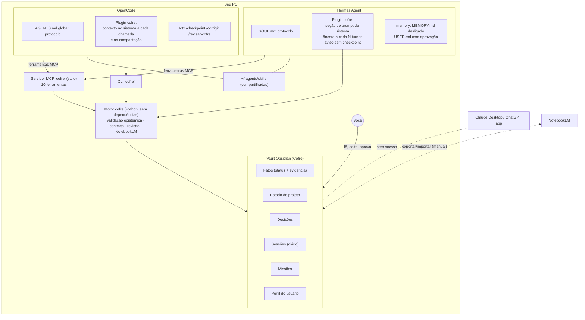

# Arquitetura

## Diagnóstico

O comportamento descrito ("lembram, mas lembram errado e defendem o erro") tem causas concretas, não é falta de inteligência do modelo:

- **Memória automática sem verificação.** O Hermes mantém `~/.hermes/memories/MEMORY.md` e `USER.md`, injetados no prompt de sistema de toda sessão. O agente grava ali sozinho, inclusive numa revisão em segundo plano depois de cada turno (`write_approval: false` por padrão). Um palpite errado vira "nota pessoal" e reaparece em todas as sessões seguintes como se fosse fato.
- **Compactação com perda.** Hermes e OpenCode resumem conversas longas. O resumo é feito pelo próprio modelo (fraco), que mistura o que foi verificado com o que foi especulado, e o detalhe que corrigia o erro some.
- **Nenhuma distinção de confiabilidade.** "Vi no `package.json`" e "acho que é assim" ocupam o mesmo espaço no contexto, com o mesmo peso.
- **Correção que não persiste.** Quando você corrige, a correção vive só naquela conversa; a informação errada continua na memória nativa.

## Princípios do desenho

1. **Uma fonte de verdade fora do modelo**, legível e editável por você: o vault do Obsidian.
2. **Status epistêmico em toda informação** (hipótese, verificado, contestado, refutado, obsoleto) e hierarquia explícita de confiança.
3. **Regras aplicadas em código.** Modelos fracos ignoram instruções; por isso as regras críticas são validadas pelo servidor (evidência conferida no disco, bloqueio de afirmação refutada, citação obrigatória do usuário para decisões aceitas, bloqueio de credenciais).
4. **Contexto reinjetado mecanicamente**, sem depender de o modelo lembrar de pedir.
5. **Erros viram anticorpos**: fatos refutados não são apagados; aparecem como armadilhas.
6. **Auditável e reversível**: cada escrita de agente vira commit git no vault, com o agente/modelo que gravou.
7. **Escopo controlado**: só agentes de terminal configurados usam o cofre; apps de chat ficam de fora.

## Componentes

| Componente | Papel |
| --- | --- |
| Vault | Fonte de verdade em Markdown com frontmatter (propriedades do Obsidian). Painéis com o core plugin Bases. |
| Motor `cofre/` | Lê/escreve notas, aplica as regras, monta o pacote de contexto, revisa e exporta. Python 3.9+ puro, roda em Windows, Linux, macOS e WSL. |
| Servidor MCP | Interface dos agentes. Mesmo binário para Hermes, OpenCode, Claude Code e Codex. Descobre o workspace por `roots/list` quando o cliente oferece. |
| Plugins | Injetam o contexto sem depender do modelo: no Hermes como seção do prompt de sistema (estável, sobrevive à compactação) mais uma âncora periódica; no OpenCode em toda chamada e no pedido de compactação. |
| Protocolo | Texto único (`adapters/shared/PROTOCOLO-AGENTE.md`) instalado no `SOUL.md` do Hermes e no `AGENTS.md` global do OpenCode. |
| Skills | Procedimentos detalhados carregados sob demanda (checkpoint, corrigir, revisar, NotebookLM). |

## Fluxos

### Início de sessão
1. Você abre o agente numa pasta de código.
2. O plugin descobre o projeto pelo diretório (campo `caminhos` do hub do projeto ou remoto git em `repos`; caminhos Windows e WSL são equivalentes).
3. O pacote de contexto entra no prompt: estado atual, armadilhas, contestados, verificados, decisões, hipóteses, missões, suas preferências e as regras.

### Descoberta durante o trabalho
1. O agente lê `docker-compose.yml` e vê `image: postgres:16`.
2. Chama `cofre_registrar_fato(afirmacao="O banco é PostgreSQL 16", status="verificado", evidencias=[{tipo: "arquivo", ref: "/caminho/docker-compose.yml:3", trecho: "image: postgres:16"}])`.
3. O motor abre o arquivo, confere o trecho, verifica duplicatas/contradições/refutados e grava. Se o trecho não existir, recusa com a explicação.

### Correção sua
1. Você diz "não é JWT, é sessão com cookie" (ou usa `/corrigir`).
2. O agente refuta o fato com evidência `usuario` (suas palavras) e registra a versão correta, ligada à antiga.
3. Dali em diante, toda sessão de qualquer IA vê: `NÃO é verdade: "A API usa JWT" — correto: "A API autentica com sessão em cookie httpOnly"`. Tentativas de registrar de novo "usa JWT" (ou paráfrases) são bloqueadas.

### Conversa longa e compactação
- Checkpoints gravam foco, próximos passos e bloqueios no `Estado` do projeto.
- No OpenCode, o plugin injeta o contexto no pedido de compactação e instrui o resumo a preservar IDs e status.
- No Hermes, a seção do prompt de sistema é congelada e preservada na compactação; a âncora reinjeta o foco atual (lido do disco) a cada N turnos.

### Revisão
- `cofre revisar` reconfere evidências de arquivo (detecta fato verificado cujo trecho mudou no código), aponta verificações vencidas, hipóteses antigas, duplicatas, contradições, decisões aceitas sem citação e credenciais coladas no vault. `--aplicar` marca como contestado o que deixou de conferir.

## Decisões de desenho e trade-offs

| Decisão | Por quê | Custo |
| --- | --- | --- |
| Arquivos Markdown, não banco vetorial | Você lê e corrige no Obsidian; git audita; zero infraestrutura | Busca é lexical (suficiente para o volume de um freelancer; dá para plugar embeddings depois) |
| Python sem dependências | Funciona com o Python do Hermes e em qualquer SO, sem `pip install` | Parser YAML próprio (subconjunto usado pelo Obsidian) |
| MCP como interface | Padrão suportado por Hermes, OpenCode, Claude Code e Codex; não toca apps de chat | Ferramentas consomem alguns milhares de tokens de schema |
| Plugins além do protocolo | Modelos fracos esquecem de pedir contexto | Plugins acompanham a API de cada ferramenta (OpenCode V2 mudou a API; o plugin já suporta V1 e V2) |
| Evidência de arquivo conferida | Detecta trecho inventado, o erro mais comum de modelo fraco | Evidência de comando/URL não é reexecutada (seria arriscado); fica a cargo da revisão humana e da política `humano` |
| Desligar `MEMORY.md` do Hermes | Elimina a segunda fonte de verdade que contaminava as sessões | O agente perde o "diário pessoal" nativo; o cofre substitui com regras melhores (reversível) |
| Similaridade lexical para refutados/duplicatas | Sem dependências, previsível, explicável na mensagem de erro | Pode deixar passar paráfrases distantes ou acusar falsos positivos (agente pode usar `forcar` em casos não idênticos; você revisa) |
